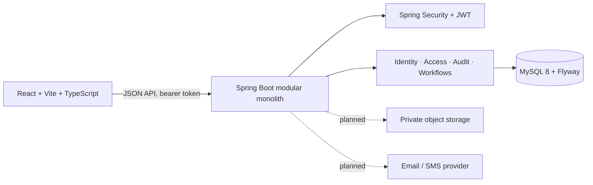
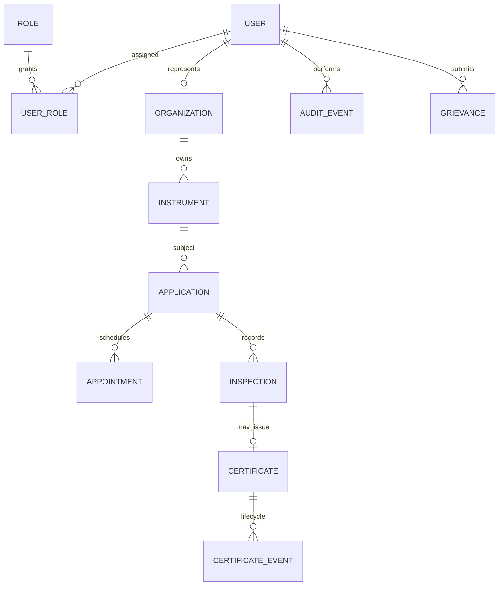

<div align="center">

# ✨ LegalMetrix

### Verify. Certify. Comply.

**A digital workspace for legal metrology services, instrument registration, verification applications, and inspection workflows.**

Prototype for Smart India Hackathon 2026 · React · TypeScript · Spring Boot · MySQL

[Features](#features-and-scope) · [How it works](#architecture) · [Get started](#local-development) · [API](#api-and-health-checks) · [Security](#security-and-vulnerability-reports) · [Contributing](#contributing) · [License](#license-and-usage-rights)

<br />


</div>

---

> **Prototype notice:** LegalMetrix is not an official government service, does not provide legal advice, and does not issue statutory approvals or certificates. Applicable rules and workflows require validation by the competent authority before operational use.

## Contents

- [Project overview](#project-overview)
- [Architecture](#architecture)
- [Features and scope](#features-and-scope)
- [Technology stack](#technology-stack)
- [Prerequisites](#prerequisites)
- [Local development](#local-development)
- [Configuration](#configuration)
- [API and health checks](#api-and-health-checks)
- [Development workflow](#development-workflow)
- [Contributing](#contributing)
- [Security and vulnerability reports](#security-and-vulnerability-reports)
- [Copyright and content claims](#copyright-and-content-claims)
- [License and usage rights](#license-and-usage-rights)
- [Acknowledgements](#acknowledgements)

## Project overview

LegalMetrix explores how legal metrology services might support instrument registration, verification applications, inspection scheduling, certificate lifecycle management, public verification, and grievance handling. The present implementation is an early prototype. Planned entities and future workflows shown below should not be read as implemented capabilities.

It is not operated by or endorsed by a government department or legal metrology authority. Applicable laws, rules, forms, fees, roles, and approval boundaries must be confirmed by the competent authority before any real-world deployment. Do not use this prototype to make legal, commercial, or compliance decisions.

## Architecture



The API is the source of truth for identity and authorization. User roles describe intended scopes; system administration does not grant statutory decision-making authority. Public certificate verification and several operational workflows are planned and may not yet be available.

### Role and access intent

| Role | Intended scope |
| --- | --- |
| Owner | Own profile, instruments, applications, and grievances |
| Legal Metrology Officer (LMO) | Assigned inspection and application work |
| Government Approved Test Centre (GATC) | Assigned centre testing queue |
| State administrator | State-scoped user and office administration |
| Central administrator | Aggregate reporting and configuration |
| Public | Public-facing services, such as certificate verification when implemented |
| Helpdesk | Assigned grievance tickets |
| System administrator | Technical account and security administration |

These are intended boundaries, not a claim that every listed workflow is implemented. The system administrator has no statutory approval authority, and administrative roles must not bypass workflow decisions.

### Data model direction



The implemented schema covers identity, roles, audit, and the instrument/application/inspection flows described in the status section. Other relationships are design direction and are not necessarily persisted yet.

## Features and scope

Current prototype functionality includes shared authentication, fixed role records and role assignments, profile updates, audit events, dashboard shell, account-owned instrument registration, initial verification applications, and inspection requests stored against applications. Inspection requests remain pending review by an authorized officer.

Certificate issuance and statutory verification decisions are not implemented. Refresh-token rotation, email verification, password recovery, persistent account lockout, and production-grade rate limiting are also future work. Browser access tokens are held in memory, so a page reload requires signing in again; clearing the client token does not revoke a JWT already issued, which expires according to its configured lifetime.

## Technology stack

| Area | Technologies |
| --- | --- |
| Backend | Java 21, Spring Boot 3.5, Spring Web, Security, Data JPA, Validation, Actuator |
| Persistence | MySQL 8, Flyway |
| Authentication | JWT (JJWT), BCrypt password hashing |
| API documentation | springdoc-openapi / Swagger UI |
| Frontend | React 19, TypeScript, Vite, React Router, Tailwind CSS |
| UI and data | Axios, React Hook Form, Zod, Recharts, Lucide, React Hot Toast |
| Checks | JUnit 5, Mockito, TypeScript compiler, Vite production build |

Dependency versions are declared in `backend/pom.xml` and `frontend/package.json`.

## Prerequisites

- Java 21 or newer
- Maven 3.9 or newer
- Node.js 20 or newer and npm
- Docker Desktop with Docker Compose
- Git

## Local development

### 1. Configure environment

At the repository root, create a local environment file using safe example values:

```powershell
Copy-Item .env.example .env
```

If `.env.example` is not present in your checkout, create `.env` from the variable list in [Configuration](#configuration). Never commit `.env` or paste its values into issues, pull requests, logs, or screenshots.

### 2. Start MySQL

From the repository root:

```powershell
docker compose up -d mysql
```

Compose publishes MySQL on port `3306` by default. Adjust the port mapping if that port is already in use and keep `DB_PORT` in sync.

### 3. Start the API

In a PowerShell terminal from the repository root:

```powershell
Set-Location backend
Get-Content ..\.env | ForEach-Object {
  if ($_ -match '^\s*([^#=]+)=(.*)$') {
    Set-Item -Path ("Env:" + $matches[1].Trim()) -Value $matches[2]
  }
}
$env:SPRING_PROFILES_ACTIVE = 'dev'
mvn spring-boot:run
```

Spring Boot does not load `.env` automatically. The PowerShell snippet loads variables into that process without printing values. To provision a local system administrator, set `BOOTSTRAP_ADMIN_EMAIL` and `BOOTSTRAP_ADMIN_PASSWORD` before the first API startup. Do not use a real or reused password.

### 4. Start the web client

In a second terminal:

```powershell
Set-Location frontend
npm install
npm run dev
```

Open `http://localhost:5173`. The API normally listens at `http://localhost:8080`.

### 5. Stop local services

Stop the API and Vite with `Ctrl+C`, then stop the database container:

```powershell
docker compose down
```

The named MySQL volume is retained. Removing volumes deletes local database state; back up anything you need before doing so.

## Configuration

Set configuration through environment variables. The checked-in Compose file provides local defaults for the database, but production secrets must come from a secret manager or deployment environment.

| Variable | Purpose |
| --- | --- |
| `MYSQL_DATABASE` | Database initialized by Compose |
| `MYSQL_USER` | Local database user |
| `MYSQL_PASSWORD` | Local database password |
| `MYSQL_ROOT_PASSWORD` | Local MySQL root password |
| `DB_HOST` | Database hostname used by the API |
| `DB_PORT` | Database port (Compose default: `3306`) |
| `DB_NAME` | API database name |
| `DB_USERNAME` | API database user |
| `DB_PASSWORD` | API database password |
| `JWT_SECRET` | JWT signing key; use a strong unique secret outside local development |
| `JWT_TTL_MINUTES` | Access-token lifetime in minutes |
| `FRONTEND_ORIGIN` | Allowed frontend origin for CORS |
| `BOOTSTRAP_ADMIN_EMAIL` | Optional local first-run administrator email |
| `BOOTSTRAP_ADMIN_PASSWORD` | Optional local first-run administrator password |

Never deploy with prototype or example credentials, the development JWT secret, broad CORS settings, or publicly exposed database ports. Rotate any secret that has been committed or shared accidentally.

## API and health checks

- Swagger UI: `http://localhost:8080/swagger-ui.html`
- OpenAPI document: `http://localhost:8080/v3/api-docs`
- Spring Boot Actuator health endpoint: `http://localhost:8080/actuator/health` (subject to the active profile)

## Development workflow

Run the backend checks from `backend`:

```powershell
mvn test
```

Build and type-check the frontend from `frontend`:

```powershell
npm run build
```

Before opening a pull request, review the diff, avoid committing generated output or secrets, and describe any migration or configuration changes. Keep Flyway migrations additive and ordered; do not rewrite a migration that may already have been applied by another developer.

## Contributing

Contributions are welcome through focused issues and pull requests. For a substantial feature or a change to authorization, data handling, or legal workflow, open an issue first so scope and intended behavior can be discussed.

### Suggested contribution process

1. Search existing issues and pull requests to avoid duplicate work.
2. Open an issue describing the problem, expected behavior, affected area, and any relevant screenshots or reproduction steps. Do not include personal, regulated, or secret data.
3. Fork the repository or create a topic branch from the project’s default branch.
4. Keep each change focused. Preserve authorization checks, audit behavior, and migration compatibility.
5. Add or update appropriate tests and documentation for behavior changes.
6. Run `mvn test` for backend changes and `npm run build` for frontend changes.
7. Open a pull request with a concise summary, rationale, verification performed, and any migration or security impact.
8. Respond to review feedback and keep the branch up to date with the default branch.

### Pull request checklist

- [ ] The change has a clear user or maintenance benefit.
- [ ] Authorization is enforced by the API, not only by the client.
- [ ] Inputs are validated and sensitive data is not logged.
- [ ] Database changes use a new Flyway migration where needed.
- [ ] Tests and documentation reflect changed behavior.
- [ ] No credentials, personal data, generated files, or unrelated formatting changes are included.
- [ ] Any third-party assets or code have compatible terms and attribution.

Use respectful, constructive language in issues and reviews. Until a project Code of Conduct is adopted, participants are expected to communicate professionally and focus on the work.

## Security and vulnerability reports

Please do not publish exploitable vulnerability details, credentials, tokens, or personal data in a public issue. The repository does not currently publish a dedicated private security contact. Until one is configured, contact the repository maintainers privately through the hosting platform’s available contact channel and share only the minimum detail needed to reproduce the issue. Allow maintainers reasonable time to investigate and coordinate a fix before public disclosure.

Do not submit real user data or production secrets with bug reports. Rotate any credential that may have been exposed.

## Copyright and content claims

If you believe material in this repository infringes your copyright or other rights, contact the repository maintainers privately through the hosting platform. Include:

- Identification of the copyrighted work or other right claimed.
- The exact repository path, commit, or URL of the material in question.
- Your contact details and a good-faith explanation of your authority to make the claim.
- The action you request, such as removal, attribution, or replacement.
- Any relevant evidence or source reference.

Please do not post private contact details or confidential supporting material in a public issue. Maintainers will review a sufficiently detailed claim and may temporarily restrict access to disputed material while investigating. This process is for routing claims and is not legal advice or a substitute for any formal notice required by applicable law.

Contributors should submit only material they created or are authorized to contribute, and should identify third-party assets with their source and license. A pull request does not transfer ownership of a contributor’s work; usage rights are governed by the applicable license and any contribution terms presented by the repository host.

## License and usage rights

This project is licensed under the **Apache License 2.0**. You may use, reproduce, modify, and distribute the project under the terms and conditions in the [`LICENSE`](LICENSE) file. The license includes conditions for preserving copyright and license notices, documenting changes, and a patent license, along with its stated limitations and disclaimer.

Unless a file or component states otherwise, project source code is provided under Apache-2.0. Third-party dependencies and assets remain subject to their own license terms; consult their notices before redistribution. The license does not grant rights to project or third-party trademarks, logos, or service marks.

## Acknowledgements

LegalMetrix is a prototype developed in the context of Smart India Hackathon 2026. The project uses open-source libraries and tools listed in its build manifests; those projects retain their respective names, copyrights, and license terms.
