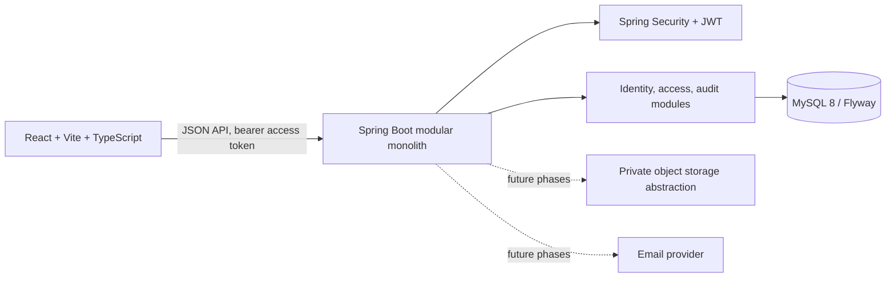
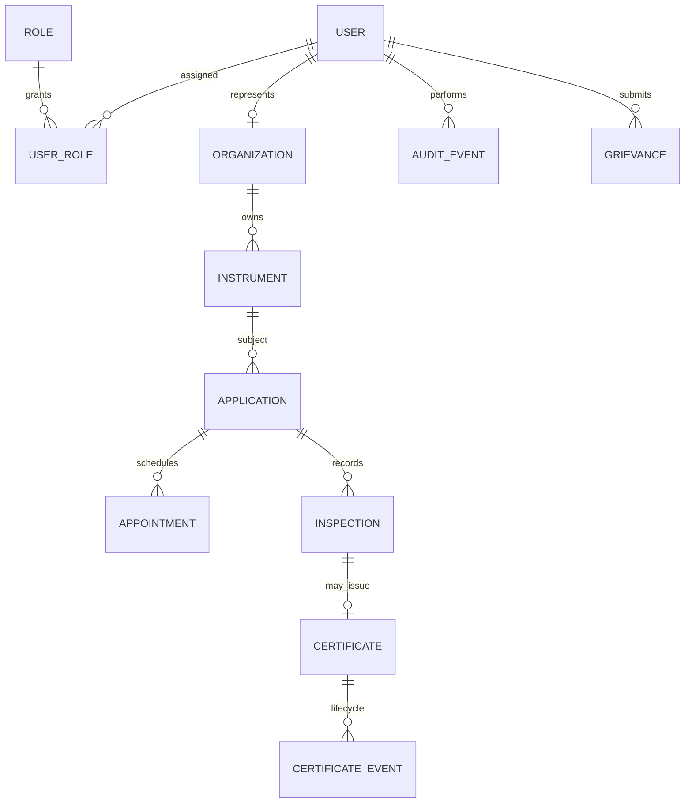

# LegalMetrix — SIH 2026 prototype

**Verify. Certify. Comply.** This repository starts a modular monolith for digital legal metrology services. It is an SIH prototype and is not an official government service. Legal rules and approval authority must be configured and validated by the competent authority before operational use.

## Phase 1 architecture



The browser uses one authentication flow and routes users according to server-issued roles. The API owns authorization and is the source of truth. Phase 1 implements identity, fixed role records, shared authentication, profile updates, audit events, and the dashboard shell. Refresh-token rotation, email verification, password recovery, persistent lockout/rate limits, and operational workflows are subsequent work. Passwords are stored using BCrypt. Development has a fallback signing secret; production requires `JWT_SECRET` and a production secrets manager.

### Role-permission matrix

| Capability | Owner | LMO | GATC | State admin | Central admin | Public | Helpdesk | System admin |
|---|---:|---:|---:|---:|---:|---:|---:|---:|
| Manage own profile | ✓ | ✓ | ✓ | ✓ | ✓ | — | ✓ | ✓ |
| Instruments/applications | Own | Assigned | Centre queue | State scope | Aggregate/config | Public verify | Assigned grievance | — |
| Statutory inspection/decision | — | Assigned authority | Authorized tests | Allocate/monitor | — | — | — | — |
| State user/office administration | — | — | — | State scope | — | — | — | — |
| Cross-state aggregate/config | — | — | — | — | ✓ | — | — | — |
| Grievances | Own | Assigned | Assigned | State scope | Aggregate | Submit/report | Assigned tickets | — |
| Security/account administration | — | — | — | Access review | — | — | — | ✓ |
| Audit visibility | Own events | Own/assigned | Own/centre | State scope | Aggregate | — | Assigned scope | Security events |

Roles are not interchangeable: system administration grants no statutory approval authority, and central administration cannot bypass workflow approvals. Public certificate verification remains anonymous. These are intended capability boundaries; workflow endpoints arrive in later phases.

### Core data relationships



Phase 1 persists users, roles, role assignments, and audit events. The remaining entities are planned relationships, not yet implemented. State/district/office scope will be represented explicitly before workflow data is added.

## Project structure

```text
backend/                 Spring Boot API, Maven, Flyway migrations
  src/main/java/...      config, identity, security, audit, common
  src/main/resources/    application profiles and migrations
  src/test/java/...      focused API/security tests
frontend/                Vite, React, TypeScript, Tailwind
  src/                    routes, auth, layouts, shared UI
README.md                 architecture, permissions, relationships, setup
```

## Stack and dependency choices

Java 21, Spring Boot 3.5.x, Maven, Spring Web, Security, Data JPA, Validation, MySQL Connector/J, Flyway, JJWT, springdoc-openapi, JUnit 5/Mockito. Frontend: React, Vite, TypeScript, Tailwind, React Router, Axios, React Hook Form, Zod, Recharts, Lucide, and React Hot Toast. Versions are pinned in the build manifests; dependency compatibility should be checked when upgrading.

## Local setup (PowerShell)

Requirements: Java 21+, Maven 3.9+, Node.js 20+, Docker Desktop with Compose. From the repository root:

```powershell
Copy-Item .env.example .env
docker compose up -d mysql
Set-Location backend
Get-Content ..\.env | ForEach-Object {
  if ($_ -match '^\s*([^#=]+)=(.*)$') {
    Set-Item -Path ("Env:" + $matches[1].Trim()) -Value $matches[2]
  }
}
$env:SPRING_PROFILES_ACTIVE = 'dev'
mvn spring-boot:run
```

In a second terminal:

```powershell
Set-Location frontend
npm install
npm run dev
```

Open `http://localhost:5173`. Swagger UI is at `http://localhost:8080/swagger-ui.html`. The PowerShell block above loads `.env` values into the backend process without printing them. Never use the development JWT secret in a deployed environment. Set `BOOTSTRAP_ADMIN_EMAIL` and `BOOTSTRAP_ADMIN_PASSWORD` before first startup to create a local system administrator; there are no committed demo credentials.

Run backend checks from `backend` with `mvn test`. Run the frontend production check from `frontend` with `npm run build`. Docker Compose reads `.env`; Spring Boot does not load `.env` automatically. In production, activate the `prod` profile and set all required secrets and service URLs in the deployment environment.

## Phase 1 scope and status

This initial increment provides the architecture baseline, schema, shared authentication, role-aware shell, and account/profile basics. Access tokens stay in browser memory; reloading requires signing in again until refresh-token rotation is implemented. Client logout clears the browser token, which remains valid at the server only until its short expiry. It is intentionally the first phase of the larger system; later phases add instrument registry, applications, inspections, certificates, grievances, reporting, and hardened deployment integrations. Do not put personal or production data into this prototype.

## Workflow data currently available

Instrument registration creates an account-owned instrument record and an initial verification application. Inspection requests are stored against an application and remain `REQUESTED` until an authorized officer reviews them. Application and inspection lists are scoped to the signed-in account. Certificate issuance and verification decisions are not implemented; this prototype does not issue statutory approvals or certificates.

## Security and operations

Use TLS, a production-grade secret manager, restricted CORS, private object storage, backups with restore drills, monitoring, dependency scanning, and configured rate limiting before deployment. LegalMetrix does not claim formal authorization or compliance certification. External email/SMS, malware scanning, object storage, and payment services require separately configured providers.
